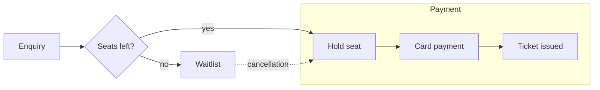

# Ferry Timetable Notes

Working notes for the summer schedule. Lectern only *reads* this file —
edit it in any editor and the window reloads on save.

## Crossings

| Route                    | Duration | Vehicles | Notes                      |
| ------------------------ | -------- | -------- | -------------------------- |
| Rønne – Ystad            | 1h 20m   | Yes      | Fastest, books up early    |
| Rønne – Køge             | 5h 30m   | Yes      | Overnight sailing          |
| Rønne – Sassnitz         | 3h 20m   | Yes      | Seasonal, May to September |
| Hammerhavn – Christiansø | 1h 00m   | No       | Passengers only            |

## Booking flow



## Before the season opens

- [x] Confirm the vehicle deck allocation
- [x] Publish the May schedule
- [ ] Decide whether to add a second Sassnitz sailing
- [ ] Review the cycle-carriage surcharge

> The Christiansø crossing does not carry vehicles at all, so it needs a
> separate note on the printed timetable.

## Fare lookup

Fares come out of `ROUTES`, keyed by route and season:

```python
def fare(route: str, season: str, vehicle: bool = False) -> int:
    """Return the fare in DKK, rounded to whole kroner."""
    base = ROUTES[route].base_fare
    if season == "high":
        base = round(base * 1.25)
    if vehicle:
        base += ROUTES[route].vehicle_supplement
    return base
```

Rates are reviewed each January — see the
[operator's published tariff](https://example.com/tariff) for the
authoritative figures.
